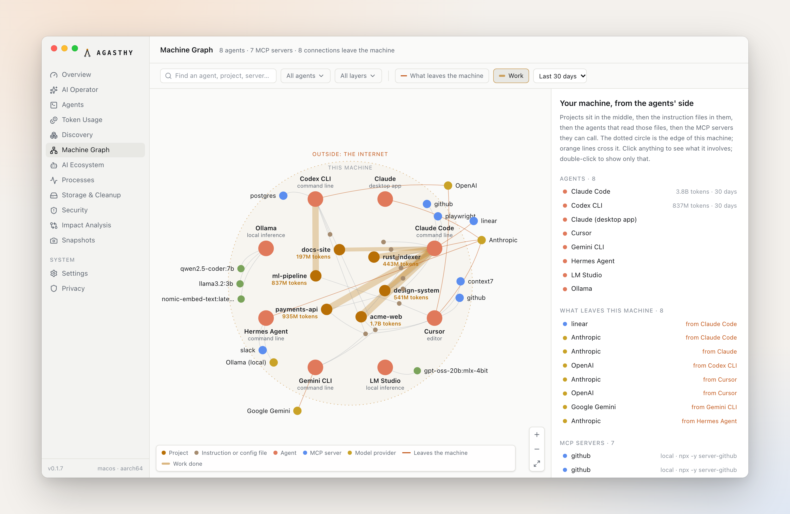

<p align="center">
  
</p>

<h1 align="center">AGASTHY</h1>

<p align="center"><strong>English</strong> · <a href="README.zh-CN.md">简体中文</a></p>

<p align="center"><strong>One intelligence layer for your developer machine.</strong></p>

<p align="center">
Every repo, runtime, package and AI tool on your machine, connected in a live knowledge graph.<br/>
Track coding agents and what they cost, see what breaks before you remove anything,<br/>
free disk space safely, and ask plain questions about your machine with evidence behind every answer.
</p>

<p align="center">
  <a href="https://github.com/HMAKT99/Agasthy/releases/download/v0.1.6/AGASTHY-0.1.6-apple-silicon.dmg"><strong>⬇ Download for Mac (Apple silicon)</strong></a> ·
  <a href="https://github.com/HMAKT99/Agasthy/releases/download/v0.1.6/AGASTHY_0.1.6_x64-setup.exe">⬇ Windows preview</a> ·
  <a href="https://github.com/HMAKT99/Agasthy/releases/download/v0.1.6/AGASTHY_0.1.6_amd64.AppImage">⬇ Linux preview</a> ·
  free and open source · no account · no telemetry
</p>

https://github.com/user-attachments/assets/2718c8ae-1576-4c4f-a494-646731a019fa


---

## Try it with one command (no desktop app needed)

Just want to see what your coding agents are running and what they cost? The command-line tool is enough:

```bash
brew install hmakt99/tap/agasthy-cli      # macOS / Linux
agasthy agents                            # live coding-agent sessions and what they left running
agasthy usage                             # token usage and estimated cost, last 30 days
claude mcp add agasthy -- agasthy mcp     # let Claude Code ask about this machine (read-only)
```

`agents`, `processes`, `usage` and `telemetry` work without the desktop app. Repositories, packages and impact analysis come from the app's scans.

## Why you'll want it

A developer machine holds hundreds of moving parts: cloned repositories, several copies of the same runtime, packages from six package managers, AI tools with their own configs, and now coding agents starting servers in every terminal. Nothing shows you how they connect, what they cost, or what is safe to remove. **AGASTHY reads the machine itself, links everything in one graph, and lets you act on it safely.**

| | |
|---|---|
| 📦 **Everything, discovered** | Repositories (branch, uncommitted work, remotes, duplicate clones), applications, CLI tools and runtimes (which copy is active, which are shadowed), and packages from Homebrew, npm, pnpm, uv, pip and cargo. Every fact carries its evidence. |
| 🕸️ **A knowledge graph of your machine** | Projects, runtimes, dependencies, packages, tools and AI configuration, linked. See which projects share a dependency and what relies on what. |
| 💥 **Impact analysis** | "What breaks if I remove this?" for any package, runtime or tool, simulated before you touch anything. Try dependency upgrades in an isolated Update Lab. |
| 🤖 **Coding agents, live** | Every Claude Code, Codex, Gemini CLI, Cursor, Aider, Hermes or OpenClaw session with its memory, ports, MCP and dev servers. When an agent exits and leaves a server running, AGASTHY says which session started it and stops it in one reviewed step. |
| 🪙 **Token spend** | Tokens, requests and estimated cost per day, session, project and model, from the agents' own local logs. Counters only, never your prompts. Export to CSV. |
| 🧠 **AI ecosystem** | Installed AI tools, providers, local models, MCP servers in every config, and instruction files (`CLAUDE.md`, `AGENTS.md`, rules) with duplicates, orphans and conflicts. |
| 💾 **Safe disk cleanup** | Rebuildable `node_modules`, `target`, virtualenvs, build output and caches. Only what Git ignores and nothing tracked, moved to a quarantine you can restore from. |
| 🛡️ **Security & snapshots** | Outdated packages, tools of unknown origin, opt-in vulnerability advisories. Snapshot your setup and get the commands to rebuild it on a new machine. |
| 💬 **Ask your machine** | "What is using my RAM?" · "Free 10 GB safely" · "Which repos haven't I touched in 90 days?" · "What breaks if I remove openssl@3?" Works with no AI model; optionally connect Ollama, LM Studio or a cloud model. |
| 🧭 **Insights + menu bar** | A ranked list of what needs attention right now (low disk, swap pressure, token spikes, stale data), one click away in the menu bar. |

## Tour

| | |
|---|---|
| <br/>**Overview.** What needs attention now, each with one action. | <br/>**Discovery.** Every repo, app, tool and package, with evidence. |
| <br/>**Machine Graph.** Projects, runtimes and dependencies, connected. | <br/>**Impact Analysis.** What breaks before you remove anything. |
| <br/>**AI Ecosystem.** Tools, MCP servers and instruction files, with conflicts flagged. | <br/>**Agents.** Every coding agent, and what it left running. |
| <br/>**Token Usage.** Tokens and cost by day, project and model. | <br/>**Processes.** Every process with its port and project. |
| <br/>**Storage & Cleanup.** Rebuildable folders into a restorable quarantine. | <br/>**Security.** Advisories, outdated and unknown-origin software. |
| <br/>**AI Operator.** Ask your machine; changes are only proposed. | <br/>**Safe by design.** Every change is a dry run you confirm. |

<sub>Screenshots and the video use a synthetic demo machine, not real data. `pnpm screenshots` and `pnpm demo:video` regenerate them.</sub>

## Built to be trusted

- **Local-first.** One SQLite file on your machine. No account, no telemetry, no analytics.
- **Nothing changes without you.** Every action is a dry run first, shows exact targets, needs your confirmation, is verified and logged.
- **Hard limits.** Never `sudo`. Never deletes Git repositories or tracked files. Never touches Docker volumes. Never stops system processes. The AI can only *propose*; it cannot run commands.
- **Evidence, not guesses.** Every fact has a source and a confidence level. What it cannot measure shows as *unavailable*, never as 0.
- **Light.** About 0.4% CPU and under 100 MB in normal use. A 13 MB app.

## Works with your coding agents

Your agent can ask AGASTHY too. The **AGASTHY skill** gives OpenClaw, Hermes, Claude Code and other agents that read [Agent Skills](https://agentskills.io) real answers about your machine: which projects have uncommitted work, what is on port 3000, what your agents spent in tokens this week, and what breaks if a package goes.

```text
/plugin marketplace add HMAKT99/Agasthy        # Claude Code: skill + MCP server
npx skills add HMAKT99/Agasthy                 # Codex, Cursor, Gemini CLI and more
hermes skills install HMAKT99/Agasthy/skills/agasthy
gemini extensions install https://github.com/HMAKT99/Agasthy   # Gemini CLI: skill + MCP server
```

Or point your agent at [`llms.txt`](llms.txt): *"Install AGASTHY for me by reading https://raw.githubusercontent.com/HMAKT99/Agasthy/main/llms.txt"*.

It runs `agasthy`, the read-only command-line tool attached to each release, and leaves every change to you. Setup for each agent: [integrations/agent-skill](integrations/agent-skill).

**Prefer MCP?** `agasthy mcp` is a read-only MCP server with nine tools (status, find, entity, impact, shared dependencies, agents, processes, token usage, telemetry) for Claude Desktop, Claude Code, Cursor, VS Code, Codex and any other MCP client:

```bash
claude mcp add agasthy -- ~/.local/bin/agasthy mcp
```

Setup for each client: [integrations/mcp](integrations/mcp).

## Install

> [!IMPORTANT]
> **Expect one security prompt on first launch.** AGASTHY is not yet signed with a paid Apple Developer ID or a Windows code-signing certificate. That does not mean anything is wrong with the download; it means the operating system cannot check who published it.
>
> - **macOS:** "Apple could not verify AGASTHY is free of malware" → **System Settings → Privacy & Security → Open Anyway**.
> - **Windows:** "Windows protected your PC" (SmartScreen) → **More info → Run anyway**.
> - **Linux:** no prompt; just make the AppImage executable.
>
> You only do this once; updates install without it. To check a download yourself, compare it with the `.sha256` file next to it on the release page (`shasum -a 256 <file>` on macOS, `Get-FileHash <file>` on Windows, `sha256sum <file>` on Linux).

**macOS (Apple silicon, macOS 12+)**

**[⬇ Download AGASTHY for macOS (Apple silicon)](https://github.com/HMAKT99/Agasthy/releases/download/v0.1.6/AGASTHY-0.1.6-apple-silicon.dmg)**

Open it and drag **AGASTHY** to **Applications**. The first time, macOS says it cannot verify the developer (the app is not notarized yet): **System Settings → Privacy & Security → Open Anyway**. Then scan your code folder.

Or with [Homebrew](https://brew.sh):

```bash
brew install --cask hmakt99/tap/agasthy     # the app
brew install hmakt99/tap/agasthy-cli        # optional: the read-only CLI and MCP server for agents
```

Using a coding agent without Homebrew? Get [⬇ the CLI](https://github.com/HMAKT99/Agasthy/releases/latest/download/agasthy-cli-macos-aarch64.tar.gz) (unpack it and put `agasthy` on your PATH) or [⬇ the Claude Desktop extension](https://github.com/HMAKT99/Agasthy/releases/download/v0.1.6/agasthy-mcp-0.1.6.mcpb) (double-click it).

**Windows (x64, preview)**

**[⬇ Download AGASTHY for Windows (x64)](https://github.com/HMAKT99/Agasthy/releases/download/v0.1.6/AGASTHY_0.1.6_x64-setup.exe)**

Run it. Windows says "Windows protected your PC" because the installer is not code-signed yet: **More info → Run anyway**. Then scan your code folder.

Using a coding agent? Also get [⬇ the CLI](https://github.com/HMAKT99/Agasthy/releases/latest/download/agasthy-cli-windows-x86_64.zip) (Claude Code, Cursor, Codex; unzip it and put `agasthy.exe` on your PATH) or [⬇ the Claude Desktop extension](https://github.com/HMAKT99/Agasthy/releases/download/v0.1.6/agasthy-mcp-0.1.6.mcpb) (double-click it).

**Linux (x64, preview)**

**[⬇ Download AppImage (any distribution)](https://github.com/HMAKT99/Agasthy/releases/download/v0.1.6/AGASTHY_0.1.6_amd64.AppImage)** · **[⬇ Download .deb (Ubuntu, Debian)](https://github.com/HMAKT99/Agasthy/releases/download/v0.1.6/agasthy_0.1.6_amd64.deb)**

AppImage: `chmod +x AGASTHY_*_amd64.AppImage` and run it. .deb: `sudo apt install ./agasthy_*_amd64.deb`. Then scan your code folder. Built and launch-tested in CI on Ubuntu; feedback from other distributions welcome.

Using a coding agent? Also get [⬇ the CLI](https://github.com/HMAKT99/Agasthy/releases/latest/download/agasthy-cli-linux-x86_64.tar.gz) (unpack it and put `agasthy` on your PATH) or [⬇ the Claude Desktop extension](https://github.com/HMAKT99/Agasthy/releases/download/v0.1.6/agasthy-mcp-0.1.6.mcpb).

AGASTHY lives in the menu bar: closing the window keeps it running, and **Quit** is in the menu-bar menu. Updates are offered in the app, signature-checked, and installed only when you click **Install and restart**.

## Supported platforms

| Platform | Status |
|---|---|
| macOS 12+ (Apple silicon) | **Supported.** Built and tested on macOS 15 / M2. |
| macOS (Intel) | Expected to work from source; not tested, no download yet. |
| Windows 10/11 (x64) | **Preview.** Installer with each release; built and tested in CI. Known gaps: graceful Stop (Force quit works), WinGet packages, GPU details. [Reports welcome](https://github.com/HMAKT99/Agasthy/issues/new). |
| Linux (x64) | **Preview.** AppImage and `.deb` with each release; built in CI and launch-tested on Ubuntu. Not yet: GPU details. [Reports welcome](https://github.com/HMAKT99/Agasthy/issues/new). |

## Everything it does

| Area | What AGASTHY does |
|---|---|
| **Live resources** | CPU (total and per core), memory, swap, disk per volume, load average, process count, top processes by memory and CPU, GPU model. Anything it cannot measure is shown as *unavailable* with a reason, never as 0. |
| **Repositories** | In folders **you choose**: finds Git working trees and reports branch, HEAD commit, last commit time, working-tree status (staged / modified / untracked / conflicted), local branch count, remotes (credentials stripped), GitHub origin, languages, frameworks, licence, manifests, size on disk, and duplicate clones of the same project. |
| **Applications** | Bundles in `/Applications`, `~/Applications` and `/System/Applications`, read from `Info.plist`. |
| **CLI tools & runtimes** | A curated catalogue of about 75 developer tools. For each copy on PATH: version, which copy is active and which are shadowed, and how it was installed (for example, it resolves into a Homebrew keg). |
| **Packages** | Read-only inventories from Homebrew (formulae and casks), npm and pnpm globals, uv tools, pip (default `python3`) and `cargo install`. A missing or failing manager is reported as such, never as "0 packages". |
| **Provenance** | Every fact carries evidence and a confidence level (*verified*, *strong*, *probable*, *unknown*). A Git remote read from the repository's own config is *verified*; an upstream taken from a Homebrew formula's homepage is *strong*. Nothing is guessed from names. |
| **Dependencies** | Reads `package.json`, `Cargo.toml`, `pyproject.toml`, `requirements.txt` and `go.mod` (including nested packages), with resolved versions from `package-lock.json`, `Cargo.lock` and `uv.lock`. Shows which dependencies your projects share. |
| **Runtime requirements & impact** | Links projects to the runtimes they declare (`engines.node`, `.nvmrc`, `requires-python`, `rust-version`, `go`, …). Answers *"what breaks if I remove this runtime?"*: for each project, whether it would break, fall back to another copy on PATH, or be unaffected, and what is unknown. Nothing is removed; it is a simulation. |
| **Machine Graph** | An interactive graph of projects, runtimes, dependencies, packages, binaries and upstream projects, with focus, depth and kind filters, search, and the evidence behind every edge. |
| **AI ecosystem** | Finds AI coding assistants, desktop AI apps and local inference engines from evidence on disk; the providers they use (with how strongly each is confirmed); MCP servers in every known config; local models; and AI instruction files (`CLAUDE.md`, `AGENTS.md`, Cursor/Copilot rules, agents, skills, commands) globally and per project, with duplicates, overlaps, orphans and potential conflicts. Credential files are only checked for existence and secrets are redacted. |
| **Processes** | Every process with CPU, memory, listening ports, the project it runs in, and why it is protected if it is. Stop or force-quit your own processes after a reviewed confirmation; system and other users' processes are refused. |
| **Storage & cleanup** | Measures dependency folders and build output in your projects (only those Git ignores and that contain no tracked files) and a fixed list of developer caches. You pick items, review a dry run, and they move to a quarantine you can restore from; space is freed when you delete them permanently. Docker build cache and dangling images can be pruned; volumes never are. |
| **Impact analysis** | "What if I remove X?" for packages, runtimes, dependencies, tools and apps: Homebrew packages that need it (from what installed kegs actually link to), executables and runtimes removed with it, and every project whose runtime would break or fall back, with unknowns and a suggested plan AGASTHY does not run. |
| **Safe Update Lab** | Try a dependency update (npm, pnpm, Cargo) in a separate Git worktree. Install and test steps run only when you approve them (install scripts off by default), and results are copied back only on request. |
| **Snapshots** | Record installed software, repositories (commit, branch, remote) and environment variable names; compare snapshots; list the commands that would bring back what is missing. Metadata only, not a backup. |
| **Security & lifecycle** | Outdated Homebrew packages, tools of unknown origin, and, if you opt in, OSV.dev advisories for npm, PyPI, crates.io and Go packages with exact versions. |
| **AI Operator** | Ask questions in plain language: *what is using my RAM*, *free 10 GB safely*, *which repos have I not touched in 90 days*, *which MCP servers are configured*, *what breaks if I remove openssl@3*. A built-in mode answers common questions with no AI model and sends nothing anywhere. Optionally connect a local model (Ollama, LM Studio, vLLM, LocalAI) or, after a separate opt-in, a cloud model (Anthropic, OpenAI, Gemini, OpenRouter, any OpenAI-compatible endpoint). The model can only read through AGASTHY's typed tools and *propose* changes; every proposal opens the same dry-run review as the rest of the app. |
| **Agents** | Every running coding-agent session (Claude Code, Codex, Gemini CLI, Cursor Agent, Aider, Hermes Agent, OpenClaw and more, plus any process that starts MCP servers) with its process tree, memory, ports and MCP/dev servers; what is still running after an agent exits, with one reviewed action to stop it; Git worktrees agents work in. |
| **Token Usage** | Tokens, requests and estimated cost per day, session, project folder and model, read from Claude Code and Codex logs and Hermes Agent's database. Counters only, never message text. |
| **Insights & menu bar** | A ranked list of what needs attention (low disk, swap pressure, processes agents left running, token spikes, stale data, security findings), and a menu-bar item with the same at a glance. |
| **Audit & privacy** | An append-only audit log of every action, and a privacy page listing exactly which programs AGASTHY may run. |

Repositories, installed packages, binaries on PATH and applications are kept as **separate kinds**. A local clone is never treated as installed software.


Repositories, installed packages, binaries on PATH and applications are kept as **separate kinds**. A local clone is never treated as installed software. Open items are in [ROADMAP.md](ROADMAP.md).

## Under the hood

Rust workspace, thin Tauri 2 shell, React UI. 290+ Rust tests, Playwright UI tests, CI on macOS, Windows and Linux.

```
apps/desktop/             React + TypeScript UI; src-tauri/ is a thin command layer
crates/core/              domain model, SQLite store (FTS5), migrations, audit log
crates/platform-adapters/ OS adapters (macOS / Windows / Linux) and the guarded command runner
crates/discovery/         repositories, software, packages, AI ecosystem, token usage
crates/graph/             graph views, shared dependencies, impact analysis
crates/process-manager/   processes, ports, coding-agent sessions
crates/cleanup/           disk analysis, safety checks, quarantine, Docker usage
crates/actions/           typed actions: plan (dry run) → confirm → execute → verify → audit
crates/ai-engine/         AI Operator: typed tools, built-in answers, model providers
crates/snapshots/         environment snapshots, comparison, reconstruction plans
crates/security/          outdated software, unknown provenance, opt-in OSV.dev advisories
crates/update-lab/        Git-worktree labs for trying dependency updates
crates/cli/               `agasthy` headless CLI (JSON output)
```

More in [docs/architecture.md](docs/architecture.md).

## Development setup

Requirements: Rust (stable, 1.90+), Node.js 20+, pnpm 10, and on macOS the Xcode Command Line Tools.

```sh
pnpm install
pnpm dev                 # runs the desktop app (Vite + Tauri)
```

Checks:

```sh
cargo fmt --all --check
cargo clippy --workspace --all-targets -- -D warnings
cargo test --workspace
pnpm typecheck && pnpm lint && pnpm test
pnpm e2e                 # Playwright UI tests (first time: pnpm e2e:setup)
pnpm check:types         # generated TS types match the Rust model
```

Headless discovery (prints JSON, changes nothing):

```sh
cargo run -p agasthy-cli -- scan ~/code --depth 4
cargo run -p agasthy-cli -- software
cargo run -p agasthy-cli -- packages
cargo run -p agasthy-cli -- telemetry
cargo run -p agasthy-cli -- impact runtime:/usr/local/bin/python3 --db <file>
```

Build a DMG (unsigned unless Apple credentials are set; see [docs/releasing.md](docs/releasing.md)):

```sh
pnpm release:mac         # output: dist/AGASTHY-<version>-apple-silicon.dmg
```

Details: [docs/development.md](docs/development.md).

## Privacy

No account, telemetry or analytics. The only network requests: an update check against this repository's Releases (can be turned off; sends nothing about your machine), OSV.dev advisory checks if you turn them on, and an AI model endpoint if you configure one (cloud models need a separate opt-in). Repositories are scanned only in folders you add. External programs run only from an allowlist, with fixed arguments, never through a shell. Full details: [docs/privacy.md](docs/privacy.md).

## Contributing

Contributions are welcome: see [CONTRIBUTING.md](CONTRIBUTING.md), [CODE_OF_CONDUCT.md](CODE_OF_CONDUCT.md) and the [ROADMAP](ROADMAP.md). Found a bug? Settings → About → **Report a problem** prepares a redacted report. Security issues: [SECURITY.md](SECURITY.md), not public issues.

## Name

*AGASTHY* is the product name. A suggested backronym, not a historical meaning: **A**utonomous **G**overnance, **A**nalysis, **S**ystems, **T**ooling & **H**ybrid intelligence.

## License

Apache License 2.0. See [LICENSE](LICENSE).

---

> [!NOTE]
> **Please note: the first launch asks for your OK once.** AGASTHY is free and not yet signed with a paid Apple or Microsoft certificate, so your system shows a warning the first time. This is expected, and the [install steps](#install) show the one click to get past it. Every download is checksummed, built in public by [GitHub Actions](https://github.com/HMAKT99/Agasthy/actions), and in-app updates are signature-checked.
