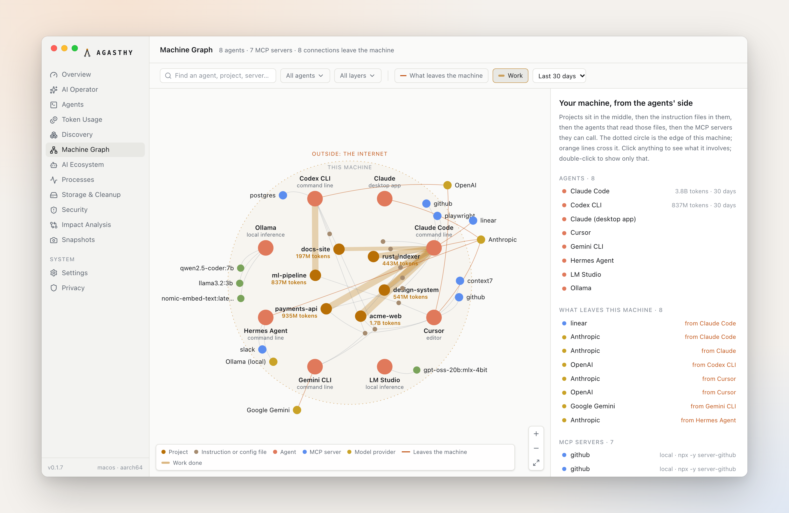

<p align="center">
  
</p>

<h1 align="center">AGASTHY</h1>

<p align="center"><a href="README.md">English</a> · <strong>简体中文</strong></p>

<p align="center"><strong>开发机的智能层：一张图看清整台机器。</strong></p>

<p align="center">
机器上的每个仓库、运行时、软件包和 AI 工具，连成一张实时知识图谱。<br/>
看清 AI 编程助手在做什么、花了多少钱，删除之前先知道会影响什么，<br/>
安全地释放磁盘空间，并且每个答案都有据可查。
</p>

<p align="center">
  <a href="https://github.com/HMAKT99/Agasthy/releases/download/v0.1.10/AGASTHY-0.1.10-macos-universal.dmg"><strong>⬇ 下载 Mac 版（Apple 芯片和 Intel）</strong></a> ·
  <a href="https://github.com/HMAKT99/Agasthy/releases/download/v0.1.10/AGASTHY_0.1.10_x64-setup.exe">⬇ Windows 预览版</a> ·
  <a href="https://github.com/HMAKT99/Agasthy/releases/download/v0.1.10/AGASTHY_0.1.10_amd64.AppImage">⬇ Linux 预览版</a> ·
  免费开源 · 无需账号 · 无遥测
</p>

<p align="center">Mac 或 Linux，一行命令安装，没有安全提示：<br/><code>curl -fsSL https://raw.githubusercontent.com/HMAKT99/Agasthy/main/install.sh | sh</code></p>

https://github.com/user-attachments/assets/2718c8ae-1576-4c4f-a494-646731a019fa

---

## 一条命令先试试（不用装桌面应用）

只想看看 AI 编程助手现在在跑什么、花了多少 token？装命令行工具就够了：

```bash
brew install hmakt99/tap/agasthy-cli      # macOS / Linux
agasthy agents                            # 正在运行的编程助手会话，以及它们留下的进程
agasthy usage                             # 最近 30 天的 token 用量和估算费用
claude mcp add agasthy -- agasthy mcp     # 让 Claude Code 也能查询这台机器（只读）
```

`agents`、`processes`、`usage`、`telemetry` 不需要桌面应用；仓库、软件包和影响分析的数据来自桌面应用的扫描。

## 为什么需要它

一台开发机上有几百个互相牵连的东西：克隆下来的仓库、同一个运行时的好几个版本、六种包管理器装的包、各有各配置的 AI 工具，现在还有在每个终端里启动服务的编程助手。没有任何工具告诉你它们之间的关系、花了多少钱、哪些可以放心删除。**AGASTHY 直接读取机器本身，把一切连成一张图，并让你安全地处理它。**

| | |
|---|---|
| 📦 **全面发现** | Git 仓库（分支、未提交的改动、远程地址、重复克隆）、应用、命令行工具和运行时（哪个版本真正生效，哪些被遮蔽），以及 Homebrew、npm、pnpm、uv、pip、cargo 安装的包（Linux 上还有 pacman、Flatpak 和 Snap）。每条信息都附带证据。 |
| 🕸️ **机器的知识图谱** | 项目、运行时、依赖、软件包、工具和 AI 配置互相关联。哪些项目共用一个依赖、谁依赖谁，一目了然。 |
| 💥 **影响分析** | 对任意软件包、运行时或工具回答“删掉它会坏什么？”，全程只模拟、不执行。依赖升级可以先在隔离的 Update Lab 里试。 |
| 🤖 **编程助手，实时可见** | Claude Code、Codex、Copilot CLI、Gemini CLI、Cursor、Aider、Hermes、OpenClaw 的每个会话：内存、端口、MCP 服务器和 dev server。助手退出后留下的服务，AGASTHY 会告诉你是哪个会话启动的，确认后一步停止。 |
| 🪙 **Token 花费** | 按天、会话、项目和模型统计 token、请求数和估算费用，数据来自各助手自己的本地日志（Claude Code、Codex、Copilot CLI、Hermes）。只读计数，绝不读取提示词。可导出 CSV。 |
| 🧠 **AI 生态** | 已安装的 AI 工具、模型提供方、本地模型、所有配置里的 MCP 服务器，以及指令文件（`CLAUDE.md`、`AGENTS.md`、规则文件），并标出重复、孤立和冲突。 |
| 💾 **安全清理磁盘** | 可重新生成的 `node_modules`、`target`、虚拟环境、构建产物和缓存。只处理被 Git 忽略的内容，先移入可恢复的隔离区。 |
| 🛡️ **安全与快照** | 过期的软件包、来源不明的工具、可选的漏洞通告。给当前环境拍快照，换新机器时得到重建所需的命令。 |
| 💬 **直接问你的机器** | “谁在占用内存？” · “安全地腾出 10 GB” · “哪些仓库 90 天没动过？” · “删掉 openssl@3 会坏什么？” 不接任何 AI 模型也能用；也可以接 Ollama、LM Studio 或云端模型。 |
| 🧭 **洞察 + 菜单栏** | 按优先级列出当前最需要处理的事（磁盘不足、内存压力、token 突增、数据过期），在菜单栏里一键可达。 |

## 界面一览

| | |
|---|---|
| <br/>**概览。** 现在需要处理什么，每项都有对应操作。 | <br/>**发现。** 每个仓库、应用、工具和软件包，都有证据。 |
| <br/>**机器图谱。** 你的智能体、它们读取和调用的内容，以及哪些数据离开本机。 | <br/>**影响分析。** 删除之前先看会坏什么。 |
| <br/>**AI 生态。** 工具、MCP 服务器和指令文件，冲突会被标出。 | <br/>**编程助手。** 每个助手，以及它留下了什么。 |
| <br/>**Token 用量。** 按天、项目和模型统计 token 与费用。 | <br/>**进程。** 每个进程及其端口和所属项目。 |
| <br/>**存储与清理。** 可重建的目录先进入可恢复的隔离区。 | <br/>**安全。** 漏洞通告、过期和来源不明的软件。 |
| <br/>**AI Operator。** 直接提问；任何改动都只是建议。 | <br/>**安全设计。** 每个改动都先 dry run，由你确认。 |

<sub>截图和视频使用的是虚构的演示机器，不是真实数据。</sub>

## 值得信任的设计

- **本地优先。** 数据只存在本机的一个 SQLite 文件里。无需账号，无遥测，无统计。
- **未经你同意，什么都不会改。** 每个操作都先 dry run，列出确切的目标，等你确认，执行后校验并记录日志。
- **硬性限制。** 绝不使用 `sudo`；绝不删除 Git 仓库或被跟踪的文件；绝不碰 Docker 卷；绝不停止系统进程。AI 只能*提出建议*，不能执行命令。
- **讲证据，不靠猜。** 每条信息都有来源和可信度。测不到的显示为*不可用*，而不是 0。
- **轻量。** 日常约 0.4% CPU、不到 100 MB 内存，应用只有 13 MB。

## 配合你的编程助手使用

你的助手也可以向 AGASTHY 提问。**AGASTHY 技能**让 OpenClaw、Hermes、Claude Code 等支持 [Agent Skills](https://agentskills.io) 的助手得到关于这台机器的真实答案：哪些项目有未提交的改动、3000 端口被谁占用、这周助手花了多少 token、删掉某个包会坏什么。

```text
/plugin marketplace add HMAKT99/Agasthy        # Claude Code：技能 + MCP 服务器
npx skills add HMAKT99/Agasthy                 # Codex、Cursor、Gemini CLI 等
hermes skills install HMAKT99/Agasthy/skills/agasthy
gemini extensions install https://github.com/HMAKT99/Agasthy   # Gemini CLI：技能 + MCP 服务器
```

也可以直接让助手读 [`llms.txt`](llms.txt)：*“请阅读 https://raw.githubusercontent.com/HMAKT99/Agasthy/main/llms.txt 并帮我安装 AGASTHY”*。

它调用的是 `agasthy`，一个随每个版本发布的只读命令行工具，所有改动都留给你自己决定。各助手的配置方法见 [integrations/agent-skill](integrations/agent-skill)。

**更喜欢 MCP？** `agasthy mcp` 是一个只读的 MCP 服务器，提供九个工具（status、find、entity、impact、shared dependencies、agents、processes、token usage、telemetry），支持 Claude Desktop、Claude Code、Cursor、VS Code、Codex 以及任何 MCP 客户端：

```bash
claude mcp add agasthy -- ~/.local/bin/agasthy mcp
```

各客户端的配置方法见 [integrations/mcp](integrations/mcp)。

## 安装

**最快的方式（macOS 或 Linux）**：没有安全提示，自动校验 SHA-256，不需要管理员权限。

```bash
curl -fsSL https://raw.githubusercontent.com/HMAKT99/Agasthy/main/install.sh | sh            # 桌面应用
curl -fsSL https://raw.githubusercontent.com/HMAKT99/Agasthy/main/install.sh | sh -s -- --cli # 桌面应用和 CLI
```

脚本从 GitHub 下载最新版本，与发布页上的 SHA-256 比对后，把 AGASTHY 装进“应用程序”（Linux：`~/Applications/AGASTHY.AppImage`）。可以先阅读 [install.sh](install.sh)；校验不通过时什么都不会安装。

> [!IMPORTANT]
> **自己下载安装包时，第一次启动会有一次安全提示。** AGASTHY 还没有购买 Apple 开发者 ID 或 Windows 代码签名证书。这不代表下载的文件有问题，只是操作系统无法验证发布者。
>
> - **macOS：** 提示“Apple 无法验证 AGASTHY 是否包含恶意软件” → **系统设置 → 隐私与安全性 → 仍要打开**。
> - **Windows：** 提示“Windows 已保护你的电脑”（SmartScreen）→ **更多信息 → 仍要运行**。
> - **Linux：** 没有提示，给 AppImage 加上可执行权限即可。
>
> 只需要做一次，之后的更新不会再提示。想自己校验下载文件，可以和发布页上同名的 `.sha256` 文件比对（macOS 用 `shasum -a 256 <文件>`，Windows 用 `Get-FileHash <文件>`，Linux 用 `sha256sum <文件>`）。

**macOS（Apple 芯片和 Intel，macOS 12+）**

**[⬇ 下载 macOS 版（Apple 芯片和 Intel）](https://github.com/HMAKT99/Agasthy/releases/download/v0.1.10/AGASTHY-0.1.10-macos-universal.dmg)**

打开后把 **AGASTHY** 拖进**应用程序**。第一次启动时 macOS 会提示无法验证开发者：先点**完成**（不要点“移到废纸篓”），再到**系统设置 → 隐私与安全性 → 仍要打开**。然后扫描你的代码目录。

或者用 [Homebrew](https://brew.sh)：

```bash
brew install --cask hmakt99/tap/agasthy     # 桌面应用
brew install hmakt99/tap/agasthy-cli        # 可选：给助手用的只读 CLI 和 MCP 服务器
```

不用 Homebrew？下载 [⬇ CLI](https://github.com/HMAKT99/Agasthy/releases/latest/download/agasthy-cli-macos-universal.tar.gz)（解压后把 `agasthy` 放进 PATH），或 [⬇ Claude Desktop 扩展](https://github.com/HMAKT99/Agasthy/releases/download/v0.1.10/agasthy-mcp-0.1.10.mcpb)（双击安装）。

**Windows（x64，预览版）**

**[⬇ 下载 Windows 版（x64）](https://github.com/HMAKT99/Agasthy/releases/download/v0.1.10/AGASTHY_0.1.10_x64-setup.exe)**

直接运行。因为安装包还没有代码签名，Windows 会提示“Windows 已保护你的电脑”：**更多信息 → 仍要运行**。然后扫描你的代码目录。

在用编程助手？再下载 [⬇ CLI](https://github.com/HMAKT99/Agasthy/releases/latest/download/agasthy-cli-windows-x86_64.zip)（解压后把 `agasthy.exe` 放进 PATH），或 [⬇ Claude Desktop 扩展](https://github.com/HMAKT99/Agasthy/releases/download/v0.1.10/agasthy-mcp-0.1.10.mcpb)（双击安装）。

**Linux（x64，预览版）**

**[⬇ 下载 AppImage（任意发行版）](https://github.com/HMAKT99/Agasthy/releases/download/v0.1.10/AGASTHY_0.1.10_amd64.AppImage)** · **[⬇ 下载 .deb（Ubuntu、Debian）](https://github.com/HMAKT99/Agasthy/releases/download/v0.1.10/agasthy_0.1.10_amd64.deb)**

AppImage：`chmod +x AGASTHY_*_amd64.AppImage` 后运行。.deb：`sudo apt install ./agasthy_*_amd64.deb`。然后扫描你的代码目录。

在用编程助手？再下载 [⬇ CLI](https://github.com/HMAKT99/Agasthy/releases/latest/download/agasthy-cli-linux-x86_64.tar.gz)（解压后把 `agasthy` 放进 PATH），或 [⬇ Claude Desktop 扩展](https://github.com/HMAKT99/Agasthy/releases/download/v0.1.10/agasthy-mcp-0.1.10.mcpb)。

AGASTHY 常驻菜单栏：关闭窗口后它仍在运行，**退出**在菜单栏菜单里。更新在应用内提示，经过签名校验，只有你点击**安装并重启**后才会安装。

## 支持的平台

| 平台 | 状态 |
|---|---|
| macOS 12+（Apple 芯片） | **正式支持。** 在 macOS 15 / M2 上构建和测试。 |
| macOS（Intel） | **预览版。** 通用版应用和 CLI 包含 Intel；在 CI 中构建，尚未在 Intel Mac 上测试。[欢迎反馈](https://github.com/HMAKT99/Agasthy/issues/new)。 |
| Windows 10/11（x64） | **预览版。** 每个版本都提供安装包，在 CI 中构建和测试。已知不足：优雅停止进程（强制退出可用）、WinGet 软件包、GPU 信息。[欢迎反馈](https://github.com/HMAKT99/Agasthy/issues/new)。 |
| Linux（x64） | **预览版。** 每个版本都提供 AppImage 和 `.deb`，在 CI 中构建并在 Ubuntu 上做启动测试。在 Arch 系发行版（Omarchy、Manjaro）上读取 pacman 数据库；尚未在 Arch 上测试。暂不支持：GPU 信息。[欢迎反馈](https://github.com/HMAKT99/Agasthy/issues/new)。 |
| Linux（ARM64） | **预览版。** 每个版本都提供 AppImage、`.deb` 和 CLI；在 CI 中构建，尚未做启动测试。 |

## 更多

- 完整功能列表、架构和开发说明见[英文 README](README.md#everything-it-does)。
- 路线图：[ROADMAP.md](ROADMAP.md) · 更新日志：[CHANGELOG.md](CHANGELOG.md)
- 问题和建议可以用中文提：[提交 issue](https://github.com/HMAKT99/Agasthy/issues/new)

Apache-2.0 协议。
